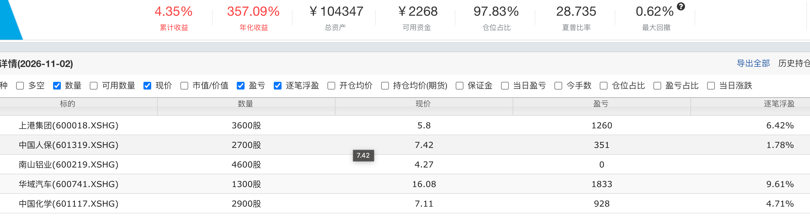
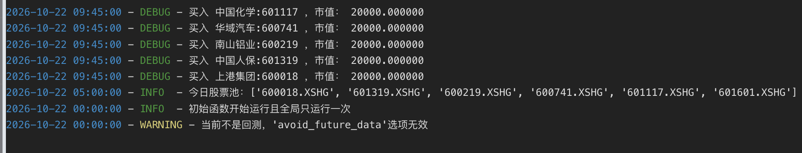

### 做了一个小实验

最近在聚宽平台上用一个很保守的策略做了个模拟实验，它从 10月22号用指标选了5只股票，以十万元的本金，分成五份，买入5只股票。每天会重新计算沪深300符合指标的股票，如果现有的股票不满足指标则剔除，新满足的买入。最近这段时间它一直没有调仓,也就是目前的持股依然满足指标。

因为最近大A受美股AI泡沫破裂的牵连，AI相关的股票集体雪崩。没有红几天，大多数时候是4000家下跌的行情。惨绝人寰、哀鸿遍野，今年赚钱的能有几个呢。

但是我将信将疑跑的这个稳健策略，表现如此亮眼，我开始审视自己的投资观点。

### 个人总结，个人观点

这里面的几只票我先前没买过，完全不了解。最开始的几天，这个持仓的收益是一个点多一点，不显眼，我就每天观察。这个策略的思想是，对于低估值的票，其内在价值早晚会回归。选的都是非常保守的红利股，市净率低的票。持有的这几天，有的票出现过亏损，有的票比如华域汽车很亮眼。

从最开始的平平无奇，到后来表现优异。通过组合分散风险，让随机起舞。这段时间股市的走势想必股民都知道，这个组合却非常稳健，暗合了我曾经提出的慢既是快的观点。倘若孤注一掷的买一只票，它的波动比这个组合大的多，对心理承受力弱的人来说不太舒服。

估值回归的思想是巴菲特宣扬的，人弃我取，别人恐惧我贪婪。市场并不总是有效的，人为的恐惧会把一些票错杀。它们的价值早晚会回归其内在价值，股价只是市场短暂的定价，它大多数时候是错误的。对于投资的观点，通过事实来验证，形成自己的信仰。

最近基金的流入是以银行、红利、白酒为主，相当于歪打正着，跟对了趋势。

市场的风格多变，或许隔一段时间这个策略就不行了，拭目以待。本文个人研究，不做投资建议。
